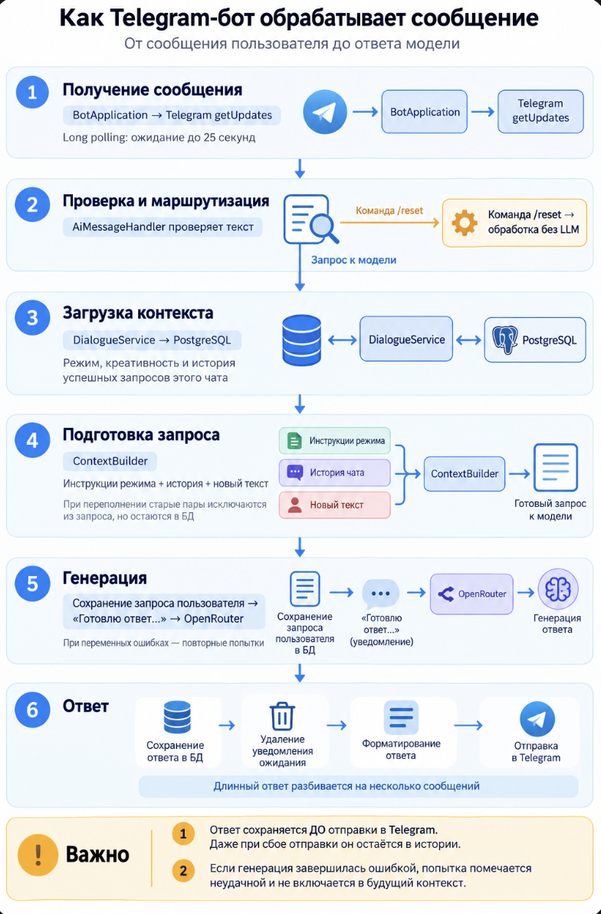

<p align="center">
  
</p>

# Nerdy AI — Telegram-бот

## Стек проекта

[](https://learn.microsoft.com/dotnet/csharp/)
[](https://dotnet.microsoft.com/)
[](https://learn.microsoft.com/aspnet/core/)
[](https://www.postgresql.org/)
[](https://www.npgsql.org/)
[](https://github.com/TelegramBots/Telegram.Bot)
[](https://openrouter.ai/)
[](https://docs.docker.com/compose/)

Учебный AI-ассистент на **C# / .NET 10**, **OpenRouter** и **PostgreSQL 16**.
Помогает с программированием, переводит тексты и проводит тренировочные опросы.
Сохраняет историю диалога, поддерживает настройку креативности и отправляет длинные ответы частями.
Работает с личными текстовыми сообщениями через long polling.

Лабораторная № 1 выполнена. Переход на C# согласован с преподавателем;
функциональные требования [методички](docs/labs-guide.md) сохраняются.

## Быстрый запуск

Нужны **.NET SDK 10**, **Docker Desktop** или **Docker Engine с Compose v2**,
токен бота от [@BotFather](https://t.me/BotFather) и ключ OpenRouter.
Запустите Docker и выполните из корня проекта:

**macOS / Linux:**

```bash
bash scripts/start.sh
```

**Windows, PowerShell:**

```powershell
powershell -NoProfile -ExecutionPolicy Bypass -File .\scripts\start.ps1
```

Утилита запросит недостающие токен и ключ, предложит прокси, сохранит `.env`,
запустит PostgreSQL и бота. Отправьте `/start` в Telegram.
Остановка — **Ctrl+C**; данные БД сохраняются.
Не запускайте одновременно несколько экземпляров бота с одним токеном.

## Команды

| Команда | Действие |
|---|---|
| `/start` | Приветствие с фото и список возможностей |
| `/menu` | Главное меню |
| `/study` | Помощь с программированием |
| `/translate` | Перевод текста |
| `/quiz` | Тренировочный опрос |
| `/settings` | Текущие режим, модель и креативность |
| `/settings 0.7` | Выбор креативности: `0.0`, `0.3`, `0.7`, `1.0` |
| `/reset` | Очистка истории с сохранением настроек |

Команды доступны и через кнопки меню. Смена режима очищает историю диалога.

## Настройки и разработка

Файл `.env` в корне проекта хранит токены, подключение к БД и параметры модели.
Создайте его по образцу [.env.example](.env.example) или через скрипт запуска.
Переменные окружения имеют приоритет над значениями файла.

```dotenv
BOT_TOKEN=
TELEGRAM_PROXY_URL=

POSTGRES_HOST=127.0.0.1
POSTGRES_PORT=5432
POSTGRES_DB=bot
POSTGRES_USER=bot
POSTGRES_PASSWORD=

LOG_LEVEL=INFO
HEALTH_PORT=8080

OPENROUTER_API_KEY=
LLM_API_BASE_URL=https://openrouter.ai/api/v1/
LLM_MODEL=qwen/qwen3.8-27b:free
LLM_TIMEOUT_SECONDS=60
LLM_RETRY_WINDOW_SECONDS=300
LLM_MAX_OUTPUT_TOKENS=2048
HISTORY_MAX_TOKENS=8192
HISTORY_MAX_MESSAGES=24
```

| Параметры | Назначение |
|---|---|
| `BOT_TOKEN` | Токен Telegram-бота от @BotFather |
| `TELEGRAM_PROXY_URL` | Необязательный локально прокси для Telegram: `http://host:port` или `socks5://host:port` |
| `POSTGRES_*` | Адрес, порт, имя БД, пользователь и пароль PostgreSQL |
| `LOG_LEVEL`, `HEALTH_PORT` | Уровень логирования и порт служебной проверки состояния |
| `OPENROUTER_API_KEY` | Ключ доступа к OpenRouter |
| `LLM_API_BASE_URL`, `LLM_MODEL` | Адрес API и идентификатор модели |
| `LLM_TIMEOUT_SECONDS` | Таймаут одной попытки запроса, в секундах |
| `LLM_RETRY_WINDOW_SECONDS` | Общий срок ожидания с повторными попытками, в секундах |
| `LLM_MAX_OUTPUT_TOKENS` | Максимальная длина ответа модели в токенах |
| `HISTORY_MAX_TOKENS` | Общий бюджет контекста, включая инструкции, историю, запрос и резерв ответа |
| `HISTORY_MAX_MESSAGES` | Максимальное число сообщений истории в запросе к модели |

Заполните `BOT_TOKEN` и `OPENROUTER_API_KEY`; скрипт запуска запросит их,
если они отсутствуют, и сгенерирует пароль БД при пустом `POSTGRES_PASSWORD`.
При ручном запуске пароль нужно задать самостоятельно.
`LLM_MAX_OUTPUT_TOKENS` должен быть меньше `HISTORY_MAX_TOKENS`.
После создания БД изменение пароля только в `.env` не меняет пароль внутри PostgreSQL.
Не публикуйте `.env`, токены и пароли.

Для запуска из IDE подготовьте БД без запуска бота:

```bash
bash scripts/start.sh --setup-only
```

На Windows добавьте `--setup-only` к команде запуска PowerShell выше.
Откройте `ItmoBot.sln`, выберите проект `app/ItmoBot.csproj`;
рабочий каталог — корень репозитория. Ручной запуск:

```bash
dotnet restore --locked-mode
dotnet run --project app
```

SQL-миграции из `app/Infrastructure/PostgreSql/Migrations/Scripts/`
применяются автоматически. Для изменений схемы добавляйте новую миграцию,
не редактируя уже применённые файлы.

## Проверки

```bash
dotnet restore --locked-mode
dotnet build --no-restore
dotnet test --no-build
dotnet format --verify-no-changes --no-restore
```

Обычный прогон не требует реальных Telegram-, LLM-запросов или БД.
Интеграционные тесты PostgreSQL включаются через `RUN_INTEGRATION=1`
и используют отдельную тестовую БД.
Сообщения коммитов — в формате Conventional Commits, например `docs: simplify readme`.

## Как работает бот


