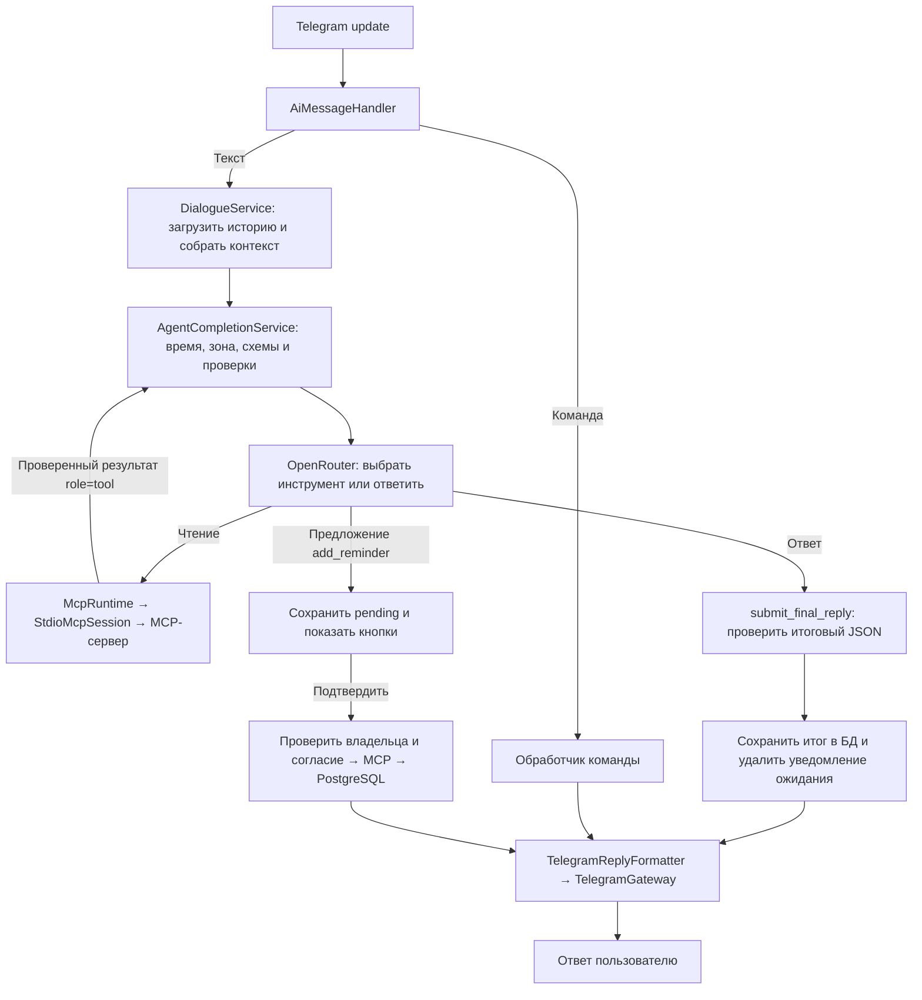

<p align="center">
  
</p>

# Nerdy AI — Telegram-бот

## Стек проекта

[](https://learn.microsoft.com/dotnet/csharp/)
[](https://dotnet.microsoft.com/)
[](https://learn.microsoft.com/aspnet/core/)
[](https://www.postgresql.org/)
[](https://www.npgsql.org/)
[](https://github.com/TelegramBots/Telegram.Bot)
[](https://openrouter.ai/)
[](https://docs.docker.com/compose/)

Учебный AI-ассистент на **C# / .NET 10**, **OpenRouter** и **PostgreSQL 16**.
Помогает с программированием, переводит тексты и проводит тренировочные опросы.
Сохраняет историю диалога, поддерживает настройку креативности и отправляет длинные ответы частями.
Работает с личными текстовыми сообщениями через long polling.

Лабораторная № 1 выполнена. Переход на C# согласован с преподавателем;
функциональные требования [методички](docs/labs-guide.md) сохраняются.

## Быстрый запуск

Нужны **.NET SDK 10**, **Docker Desktop** или **Docker Engine с Compose v2**,
токен бота от [@BotFather](https://t.me/BotFather) и ключ OpenRouter.
Запустите Docker и выполните из корня проекта:

**macOS / Linux:**

```bash
bash scripts/start.sh
```

**Windows, PowerShell:**

```powershell
powershell -NoProfile -ExecutionPolicy Bypass -File .\scripts\start.ps1
```

Утилита запросит недостающие токен и ключ, предложит прокси, сохранит `.env`,
запустит PostgreSQL и бота. Отправьте `/start` в Telegram.
Остановка — **Ctrl+C**; данные БД сохраняются.
Не запускайте одновременно несколько экземпляров бота с одним токеном.

## MCP-сервер: текущий этап лабораторной № 2

Отдельный проект `mcp/` использует официальный C# MCP SDK 2.3.0 и транспорт `stdio`.
Бот сам запускает дочерний MCP-процесс после миграций, получает каталог
возможностей и хранит сессию до остановки. Проект `mcp` автоматически собирается
при сборке `app`. Отдельный запуск нужен только для независимой проверки сервера:

```bash
dotnet run --project mcp --no-build
```

Он ожидает MCP-запросы в стандартном вводе; ответы протокола идут в stdout,
диагностика — в stderr. Закрытие входного потока или Ctrl+C завершает процесс.
При подключении из MCP-клиента используйте `--no-build`, чтобы вывод сборки
не попадал в протокол.

В боте используются интерфейсы MCP-клиента и сессии, инфраструктурный адаптер
и сервис `McpRuntime`. Адаптер запускает сервер, ограничивает время операций,
сохраняет отмену и возвращает безопасные ошибки без секретов и внутренних путей.
`McpRuntime` освобождает сессию при остановке бота. Недоступность MCP или ошибка
каталога записывается безопасным кодом в журнал и не блокирует обычный диалог.
Перед выдачей сохранённого каталога сервис проверяет связь; при разрыве не
возвращает устаревшие возможности. Автоматического переподключения пока нет.
Метод `IMcpSession.DiscoverAsync` получает каталог инструментов с `inputSchema`,
`outputSchema` и описаниями, а также URI и метаданные ресурсов. Каталог собирается
из всех страниц; неверные описания, дубликаты и повторяющиеся курсоры дают ошибку.
При отсутствии возможностей сервера список пуст. Обнаружение ограничено общим
тайм-аутом, 256 элементами каждого вида и 32 продолжениями пагинации.
Сейчас сервер предоставляет `get_schedule`, `get_weather`, `add_reminder`
и ресурс `schedule://current-week`.
Агентный цикл подключён к диалогу: модель предлагает нативный tool call, бот
проверяет схему и вызывает MCP. Результат передаётся модели как недоверенные данные
с источником, после чего пользователю отправляется проверенный итоговый текст.
Лимит — два MCP-вызова на сообщение. Всё сообщение обрабатывается в пределах
одного LLM_RETRY_WINDOW_SECONDS, включая несколько обращений к модели и MCP. Сохраняются история и режимы первой работы.
Итоговый ответ агента имеет JSON-контракт action/text/reason; пользователь видит
только text. Провайдер должен поддерживать tools и выбранный response_format;
строгая проверка JSON Schema выполняется в приложении.
По умолчанию используется `nvidia/nemotron-3.5-super-vl:free` (NVIDIA Nemotron).
Gemma временно ограничена бесплатным провайдером (HTTP 429).
Для Nemotron задан `LLM_STRUCTURED_OUTPUT_MODE=tool_compatible_json`.
При наличии MCP-инструментов клиент добавляет локальную служебную функцию
`submit_final_reply` со схемой action/text/reason и передаёт `tool_choice=required`.
Модель выбирает настоящий MCP tool call либо эту функцию для обычного ответа
или уточнения. Служебная функция не публикуется MCP-сервером и не выполняет
внешних действий. Её аргументы строго проверяются; смешивание с другими вызовами
отклоняется. Обычный текст вместо обязательного выбора даёт безопасную ошибку.
Полный код передаётся внутри text; отдельного оформления черновика больше нет.
Все сообщения и добавленная схема учитываются в бюджете контекста; срок и отмена общие.
После добавления служебной схемы при необходимости удаляются старые полные пары
истории. Инструкция режима, обязательные примеры, текущий вопрос и результаты
инструментов сохраняются.

Polling обрабатывает до восьми обычных обновлений и до двух callback одновременно.
Обычные сообщения одного чата выполняются по порядку; кнопки подтверждения
не ждут генерации ответа. Telegram offset подтверждает только завершённые
обновления по порядку; повторно полученные updates не запускаются повторно.
Другие режимы `json_schema` и `json_object` сохраняют прежнее поведение.

Настройки адаптера (новые поля `.env` необязательны, используются эти значения):

```dotenv
MCP_SERVER_PATH=mcp/bin/Debug/net10.0/ItmoBot.Mcp.dll
MCP_TIMEOUT_SECONDS=15
```

Путь к DLL задаётся только конфигурацией; относительный путь считается от рабочей
папки бота. Для Release-сборки замените `Debug` на `Release`, для публикации укажите
путь к опубликованной DLL. Docker-образ содержит сервер в `/app/mcp/`;
в Compose путь `/app/mcp/ItmoBot.Mcp.dll` задан автоматически.
Тайм-аут подключения и каждого отдельного запроса —
от 1 до 15 секунд. Серверу передаются только необходимые системные переменные;
окружение с токенами бота и LLM не наследуется.

Расписание хранится в [mcp/Data/schedule.json](mcp/Data/schedule.json): это
демонстрационные занятия без персональных данных за 12 октября — 8 ноября 2026 года.
Формат источника — объект `days`, в каждом дне `date` и массив `lessons`;
у занятия обязательны `start`, `end`, `title`, `location`. Даты — `YYYY-MM-DD`,
время — `HH:mm`, окончание позже начала. Название и место — 1–200 символов
без управляющих символов. Даты в файле не повторяются.

```dotenv
# Необязательный собственный источник; иначе используется комплектный JSON рядом с DLL.
# SCHEDULE_FILE=/absolute/path/to/schedule.json
SCHEDULE_TIMEZONE=Europe/Moscow
```

`get_schedule` принимает только `date`. Возвращает дату, зону, занятия и источник
`repository_schedule`; для даты без записанных занятий массив пуст. Отсутствующий
или повреждённый файл даёт ошибку `source_unavailable`, неверные аргументы —
`invalid_arguments`. Ошибка инструмента содержит `isError: true` и структурированные данные.

Ресурс `schedule://current-week` возвращает JSON с семью днями с понедельника
по воскресенье в `SCHEDULE_TIMEZONE`, включая пустые дни. Этот пояс общий для
расписания и не зависит от будущих пользовательских настроек напоминаний.
В контейнере источник по умолчанию — `/app/mcp/Data/schedule.json`; собственный
файл нужно разместить в контейнере и указать его контейнерный путь.
При отдельном запуске MCP настройки передаются через окружение или аргументы
Hosting; `.env` читает бот, который явно передаёт серверу только нужные значения.

Для погоды подготовлен HTTP-клиент Open-Meteo: фиксированные запросы
[поиска населённых пунктов](https://open-meteo.com/en/docs/geocoding-api) и
[текущей погоды по координатам](https://open-meteo.com/en/docs). Он кодирует
параметры, использует HTTPS и отключает перенаправления. Теперь поверх него
реализован `IWeatherService.GetCurrentWeatherByCityAsync`: поиск города,
обработка неоднозначности и преобразование JSON в проверенные модели погоды.
`get_weather` доступен через MCP с аргументом `city` и входной/выходной схемами.
Успех содержит температуру в °C, код WMO, ветер в km/h, время наблюдения со
смещением, IANA-зону и источник `open_meteo`. Неоднозначность и отсутствие города
возвращаются как `ambiguous` и `not_found`; ошибки — как `isError` с кодом.
Проверить обнаружение и вызовы можно независимым MCP-клиентом. Вызов по естественному запросу подключён через агентный цикл;
реальную совместимость выбранной модели нужно подтвердить перед демонстрацией.

```dotenv
WEATHER_HTTP_TIMEOUT_SECONDS=5
WEATHER_HTTP_MAX_ATTEMPTS=2
```

Тайм-аут одной попытки — 1–5 секунд, включая чтение тела; максимум попыток — 1–2.
Повтор выполняется после сетевой ошибки, 429 или 5xx. Обычная задержка — 250 мс;
короткий `Retry-After` до секунды соблюдается, при большем ожидании сразу
возвращается ошибка без досрочного повтора. Тайм-аут, остальные HTTP-ошибки и
некорректный JSON не повторяются. Отмена запроса сохраняется. Ответ ограничен
1 МиБ и JSON-глубиной 32. Реальные запросы к API тестами не выполняются.

Погодный сервис возвращает отдельные результаты: погода, город не найден,
несколько совпадений или ошибка. При нескольких местах возвращаются варианты
с городом, страной и областью; погода до уточнения не запрашивается. Формат запроса
— город либо город с одной страной/областью после запятой. Известные названия стран
и ISO-коды нормализуются в фильтр `countryCode`, который повторно проверяется
после геокодирования. Прочие уточнения сверяются с названием страны или области
в ответе; неподдержанные уточнения требуют исправления. Для неоднозначных названий
вроде `Georgia` или «Конго» нужно указать точный ISO-код. Первый результат не выбирается.

Парсеры проверяют обязательные поля, координаты, IANA-зоны, конечность чисел,
температуру не ниже абсолютного нуля, неотрицательный ветер, код WMO и ожидаемые
единицы (`°C`, `km/h`, Unix seconds). Время наблюдения преобразуется из Unix timestamp
в зону ответа через NodaTime, включая DST, как описано в
[документации Open-Meteo](https://open-meteo.com/en/docs).
Обе HTTP-стадии используют общий бюджет `MCP_TIMEOUT_SECONDS`; отмена сохраняется.

Проверка соединения и обнаружения без Telegram, LLM и БД:

```bash
dotnet test ItmoBot.sln --filter "FullyQualifiedName~Mcp|FullyQualifiedName~Schedule|FullyQualifiedName~Weather"
```

## Команды

| Команда | Действие |
|---|---|
| `/start` | Приветствие с фото и список возможностей |
| `/menu` | Главное меню |
| `/study` | Помощь с программированием |
| `/translate` | Перевод текста |
| `/quiz` | Тренировочный опрос |
| `/settings` | Текущие режим, модель и креативность |
| `/settings 0.7` | Выбор креативности: `0.0`, `0.3`, `0.7`, `1.0` |
| `/reset` | Очистка истории с сохранением настроек |

Команды доступны и через кнопки меню. Смена режима очищает историю диалога.

## Настройки и разработка

Файл `.env` в корне проекта хранит токены, подключение к БД и параметры модели.
Создайте его по образцу [.env.example](.env.example) или через скрипт запуска.
Переменные окружения имеют приоритет над значениями файла.

```dotenv
BOT_TOKEN=
TELEGRAM_PROXY_URL=

POSTGRES_HOST=127.0.0.1
POSTGRES_PORT=5432
POSTGRES_DB=bot
POSTGRES_USER=bot
POSTGRES_PASSWORD=

LOG_LEVEL=INFO
HEALTH_PORT=8080

OPENROUTER_API_KEY=
LLM_API_BASE_URL=https://openrouter.ai/api/v1/
LLM_MODEL=nvidia/nemotron-3.5-super-vl:free
LLM_STRUCTURED_OUTPUT_MODE=tool_compatible_json
LLM_TIMEOUT_SECONDS=60
LLM_RETRY_WINDOW_SECONDS=300
LLM_MAX_OUTPUT_TOKENS=2048
HISTORY_MAX_TOKENS=32768
HISTORY_MAX_MESSAGES=24
```

| Параметры | Назначение |
|---|---|
| `BOT_TOKEN` | Токен Telegram-бота от @BotFather |
| `TELEGRAM_PROXY_URL` | Необязательный локально прокси для Telegram: `http://host:port` или `socks5://host:port` |
| `POSTGRES_*` | Адрес, порт, имя БД, пользователь и пароль PostgreSQL |
| `LOG_LEVEL`, `HEALTH_PORT` | Уровень логирования и порт служебной проверки состояния |
| `OPENROUTER_API_KEY` | Ключ доступа к OpenRouter |
| `LLM_API_BASE_URL`, `LLM_MODEL` | Адрес API и идентификатор модели |
| `LLM_STRUCTURED_OUTPUT_MODE` | `tool_compatible_json` для Nemotron; также доступны `json_schema` и `json_object`. Локальная проверка схемы обязательна во всех режимах |
| `LLM_TIMEOUT_SECONDS` | Таймаут одной попытки запроса, в секундах |
| `LLM_RETRY_WINDOW_SECONDS` | Общий срок ожидания с повторными попытками, в секундах |
| `LLM_MAX_OUTPUT_TOKENS` | Максимальная длина ответа модели в токенах |
| `HISTORY_MAX_TOKENS` | Общий бюджет контекста, включая инструкции, историю, запрос и резерв ответа |
| `HISTORY_MAX_MESSAGES` | Максимальное число сообщений истории в запросе к модели |

Заполните `BOT_TOKEN` и `OPENROUTER_API_KEY`; скрипт запуска запросит их,
если они отсутствуют, и сгенерирует пароль БД при пустом `POSTGRES_PASSWORD`.
При ручном запуске пароль нужно задать самостоятельно.
`LLM_MAX_OUTPUT_TOKENS` должен быть меньше `HISTORY_MAX_TOKENS`.
После создания БД изменение пароля только в `.env` не меняет пароль внутри PostgreSQL.
Не публикуйте `.env`, токены и пароли.

Для запуска из IDE подготовьте БД без запуска бота:

```bash
bash scripts/start.sh --setup-only
```

На Windows добавьте `--setup-only` к команде запуска PowerShell выше.
Откройте `ItmoBot.sln`, выберите проект `app/ItmoBot.csproj`;
рабочий каталог — корень репозитория. Ручной запуск:

```bash
dotnet restore --locked-mode
dotnet run --project app
```

SQL-миграции из `app/Infrastructure/PostgreSql/Migrations/Scripts/`
применяются автоматически. Для изменений схемы добавляйте новую миграцию,
не редактируя уже применённые файлы.

Миграция `002_agent_reminders.sql` готовит таблицы пользователей и их зон,
подготовленных действий, подтверждений, напоминаний и аудита. Существующие диалоги
сохраняются. Репозитории в `agent/Infrastructure/PostgreSql/` работают через
общий пул: сохраняют зону, готовят/подтверждают действия, атомарно создают напоминания
и пишут аудит. Контракты и модели находятся в `agent/Application/`.
Повтор запроса возвращает прежний результат, чужие действия недоступны,
смена зоны отменяет ожидающие подтверждения. Общая библиотека `agent/` используется
ботом и MCP-сервером, без зависимости сервера от app.

`add_reminder` принимает только `text` и `remind_at` с явным смещением/Z.
Доверенный клиент передаёт HMAC-контекст отдельно в `_meta`: ID действия,
владельца/чат, хеш параметров, версию, срок и подпись. Сервер повторно проверяет
контекст и подтверждение в БД. Повтор возвращает тот же ID и `created: false`.
Ответ содержит `reminder_id`, `remind_at`, `timezone`, `created`; ошибки — `isError`.
Независимый клиент без доверенного контекста может обнаружить инструмент,
но не создать напоминание. Отправка уведомлений по времени относится к лабе № 3.

При обычном запуске бот создаёт ключ на соединение и передаёт в дочерний процесс
служебные `MCP_SIGNING_KEY` и `MCP_POSTGRES_CONNECTION_STRING` (из `POSTGRES_*`).
В `.env` бота добавлять их не нужно. Миграции применяет бот перед запуском MCP.
Для независимого теста записи нужны отдельная подготовленная БД, тестовый ключ
и подтверждённое действие; без этих настроек запись запрещена. Не публикуйте
ключ, строку подключения и содержимое `_meta`.

`IMcpSession.ExecuteReminderAsync` реализует подписанный вызов. Агент перехватывает
предложение напоминания: при известной зоне сохраняет pending и показывает точные
параметры с кнопками «Подтвердить» / «Отменить» сразу после исходного запроса.
Писать «подтверждаю» отдельным сообщением не требуется: согласие принимается кнопкой.
До согласия add_reminder на MCP-сервере не вызывается.
Подтверждение действует 5 минут. Смена зоны или новый запрос отменяет ожидающее
действие; параметры на кнопке не передаются и берутся из БД. После создания бот
сообщает ID и точное время с зоной, повторное нажатие не создаёт вторую запись.
При сбое MCP подтверждённое действие можно повторить. Состояния сохраняются при
перезапуске; уведомления по времени относятся к лабораторной № 3.

Команды доступны и на кнопках главного меню:

- `/tools` — обнаруженные MCP-инструменты, отметки чтения/изменения и ресурс недели;
- `/timezone` — текущая зона, `/timezone Europe/Moscow` — сохранить зону IANA;
- `/why` — время, действие, безопасные аргументы, статус, причина и длительность
  последнего решения только вашего пользователя и чата.

Пример: `/timezone Europe/Moscow` → просьба о напоминании → проверка текста/времени
в сообщении бота → кнопка «Подтвердить». Создание выполняется только после проверки
владельца и подтверждения через MCP. Контрольные результаты реальной модели/MCP с отдельной PostgreSQL сохранены
в `docs/experiments/lab2/`. Автоматические проверки подменяют LLM/Telegram;
обязательный эксперимент на 12 запросах остаётся отдельной задачей.

## Проверки

```bash
dotnet restore --locked-mode
dotnet build --no-restore
dotnet test --no-build
dotnet format --verify-no-changes --no-restore
```

Обычный прогон не требует реальных Telegram-, LLM-запросов или БД.
Интеграционные тесты PostgreSQL включаются через `RUN_INTEGRATION=1`
и используют отдельную тестовую БД.

В `tests/Integration` сценарии сгруппированы по функциям: Agent, Conversations,
Mcp, Reminders, Schedule, Storage и Weather. В `tests/Unit` ошибки настроек
собраны в SettingsLoaderTests, форматирование и разбиение текста — в
TelegramReplyFormatterTests. Общие фикстуры — в Support, подмены — в TestDoubles.
Сообщения коммитов — в формате Conventional Commits, например `docs: simplify readme`.

## Где искать код

```text
app/
  Program.cs                 Аргументы, настройки, сборка приложения
  Hosting/                   Запуск, DI-scope, миграции и освобождение ресурсов
    Composition/Registrations/
      ApplicationRegistration.cs     Сценарии, команды, контекст и форматирование
      InfrastructureRegistration.cs  Telegram, OpenRouter, MCP и healthcheck
      PostgreSqlRegistration.cs      Пул, миграции и репозитории
      LoggingRegistration.cs         Безопасные журналы
  Application/
    BotApplication.cs        Получение обновлений Telegram
    Conversations/           История, состояние и DialogueService
      Context/               Подготовка и бюджет запроса
      Prompts/               Инструкции трёх режимов
    AgentLoop/               Выбор действий, проверки и агентный цикл
    Reminders/               Подготовка, кнопки и подтверждение напоминаний
    Commands/                Команды и главное меню
    Messaging/               Приём, форматирование и отправка сообщений
    Llm/                     Контракты модели и повторные попытки
    Mcp/                     Каталог, сессия и контракты MCP
    Storage/                 Контракты БД и миграций
    Health/                  Контракты проверки готовности
    Logging/                 Контракты скрытия секретов
  Configuration/Secrets/     Обёртки токенов, пароля и прокси со скрытием секретов
  Validation/                Проверки настроек, Telegram и LLM-входов
  Infrastructure/            HTTP, Telegram SDK, MCP SDK, PostgreSQL
agent/                       Общие напоминания, хранилища и подпись контекста
  Application/Models/        Действия, владелец, время и IANA-зона
  Shared/Results/            Общие Result и Result<T>
  Shared/Validation/         Проверки идентификаторов и параметров действий
mcp/                         Отдельный MCP-сервер, три инструмента и ресурс
```

Интерфейсы остаются у внешних границ и заменяемых сценариев. Внутренние парсеры,
форматтеры и сборщики используются непосредственно. Простые операции возвращают
`Result` или `Result<T>`; специальные варианты результата сохранены для LLM,
погодных данных, подтверждений и других сценариев с разными исходами.
Идентификаторы, тексты, креативность и лимиты представлены стандартными типами
(`long`, `Guid`, `string`, `decimal`, `TimeSpan`). Проверки сосредоточены в
`app/Validation`, `agent/Shared/Validation` и `mcp/Validation`; недопустимые входы
отклоняются до выполнения операции. Составные модели владельца и времени,
IANA-зона и обёртки секретов сохранены. Один самостоятельный тип — один файл.

Схема и формат результата MCP-инструмента находятся в его endpoint.
`OpenRouterLlmClient` содержит HTTP-вызов, создание запроса и разбор ответа;
`TelegramGateway` — транспорт Telegram; `TelegramReplyFormatter` — всё форматирование
и разбиение текста. Для этих частей больше не нужно искать отдельные фабрики
и интерфейсы. Производственных C#-файлов стало **235 вместо 388**.

## Как работает бот

Запуск: `Program → ApplicationRunner → BotHost → BotApplication`. `BotHost`
создаёт DI-scope, применяет миграции, подключает MCP и запускает polling.
Освобождение scope закрывает MCP и ресурсы БД, в том числе при ошибке или отмене.



Для Nemotron обязательный выбор нативной функции отделяет MCP-действие от завершения ответа.
Результаты инструментов чтения возвращаются модели; пользователь видит поле `text`.
Параметры подтверждения и сообщение о создании напоминания формирует приложение
по сохранённому действию и проверенному результату MCP. Максимум — два MCP-вызова
на сообщение, общий срок всех обращений ограничен настройкой ожидания.

Чтобы проследить обычный запрос, начните с `Messaging/AiMessageHandler.cs`, затем
откройте `Conversations/DialogueService.cs` и `AgentLoop/AgentCompletionService.cs`.


## Эксперимент маршрутизации лабораторной № 2

Из корня репозитория после сборки:

```bash
dotnet build ItmoBot.sln --configuration Release
DOTNET_SYSTEM_NET_DISABLEIPV6=1 MCP_SERVER_PATH="$PWD/mcp/bin/Release/net10.0/ItmoBot.Mcp.dll" dotnet run --project tools --configuration Release --no-build -- evaluate-routing docs/experiments/lab2/routing-new.json
```

Утилита читает настройки и ключ из `.env`, обнаруживает реальные MCP-схемы и
последовательно отправляет 12 запросов из `docs/evaluation/lab2-routing.json`.
Время фиксировано набором, креативность — 0.0, история каждого запроса пуста.
Проверяется первый выбор инструмента и его аргументы; инструменты и запись
напоминаний не выполняются. При ошибке провайдера прогон сохраняется незавершённым.
Существующий файл результата не перезаписывается. Дополнительный аргумент
после пути результата — путь завершённого базового прогона: тогда повторяются
только ошибочные случаи. Оценки поднабора не являются оценками полного набора.
IPv4 используется для обхода наблюдавшейся локальной ошибки Socket InvalidArgument.

Результаты и анализ прогона 06.11.2026: [эксперимент лабораторной № 2](docs/experiments/lab2/README.md).
Первоначальный результат — 4/12 действий и 1/9 аргументов; после исправления протокола выбора — **11/12 и 8/9**, пороги достигнуты.


При подтверждённом исчерпании суточной free-квоты OpenRouter бот возвращает
`LlmDailyQuotaExceeded`: лог явно сообщает об исчерпании и времени сброса UTC,
если оно передано API. Бесполезные повторы до пятиминутного тайм-аута прекращаются.
Пользователь сразу получает сообщение о суточном лимите. Обычный HTTP 429
без подтверждения суточной квоты остаётся временным ограничением с повторами.
Тела ошибок API, ключи и переписка в диагностические сообщения не включаются.


## Использование AI при разработке

При разработке использовался OpenAI Codex: для переноса шаблона на C#, обсуждения
архитектуры, реализации MCP и агентного цикла, подготовки тестов, поиска ошибок
и оформления документации. OpenRouter и модель NVIDIA Nemotron используются
самим ботом для ответов и выбора инструментов.

Пример исправленного предложения AI: первоначально клиент разрешал модели
описать вызов инструмента обычным текстом, а затем отдельным запросом оформлял
ответ в JSON. Эксперимент показал только 4/12 правильных действий и 1/9 аргументов:
описание функции не запускало MCP. Протокол заменён обязательным нативным
выбором инструмента или локальной submit_final_reply, со строгой проверкой
аргументов. Новый полный прогон дал 11/12 действий и 8/9 аргументов.
Результаты разных версий сохранены в docs/experiments/lab2/ и не объединены.

По запросу автора проекта предложенная архитектура также была упрощена:
удалены избыточные простые Value Objects и интерфейсы без альтернативных
реализаций; сохранены проверки входов, права владельца, подтверждение действий
и транзакции. Корректность проверялась сборкой, автоматическими тестами
и экспериментом; автору необходимо понимать код и объяснить его на защите.
